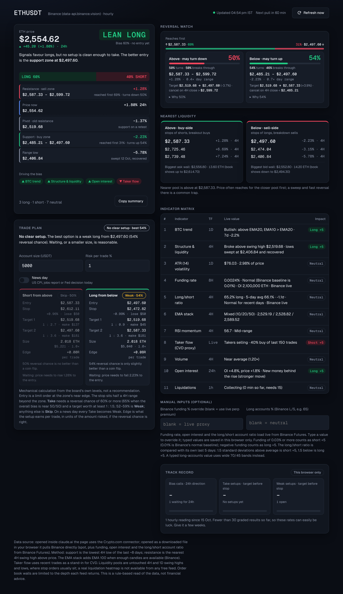
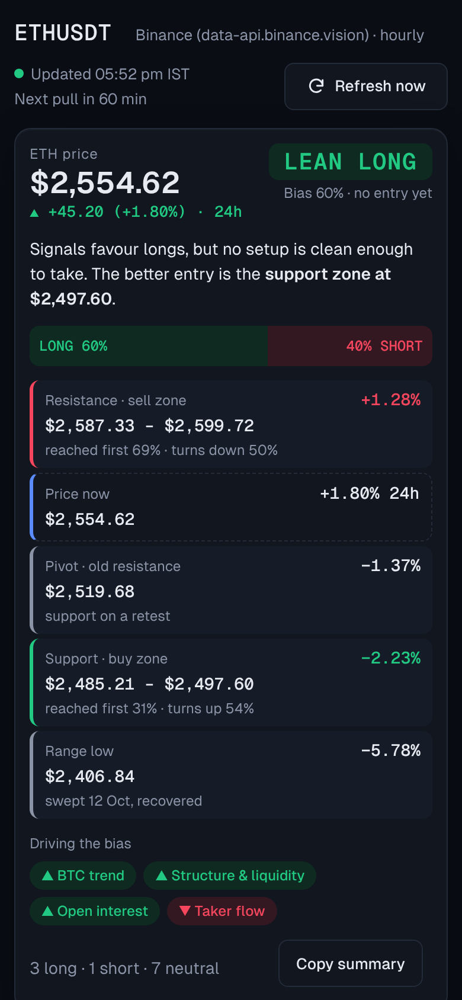
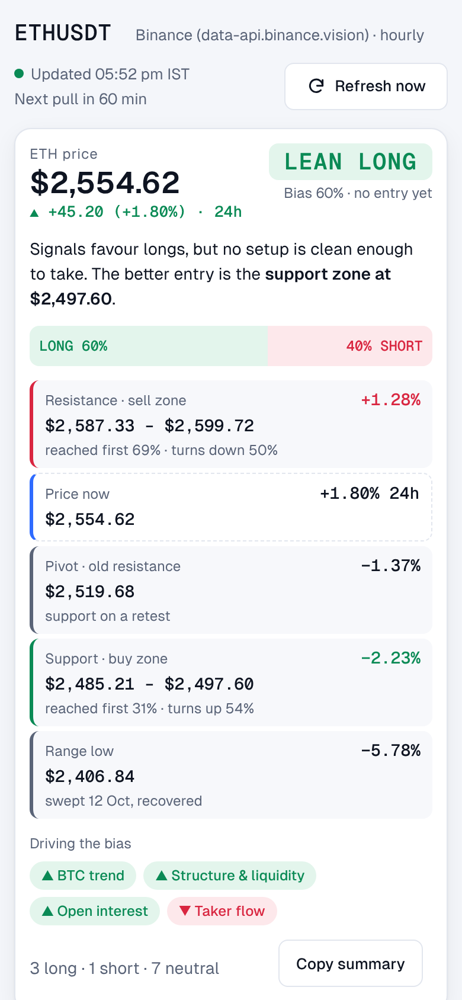
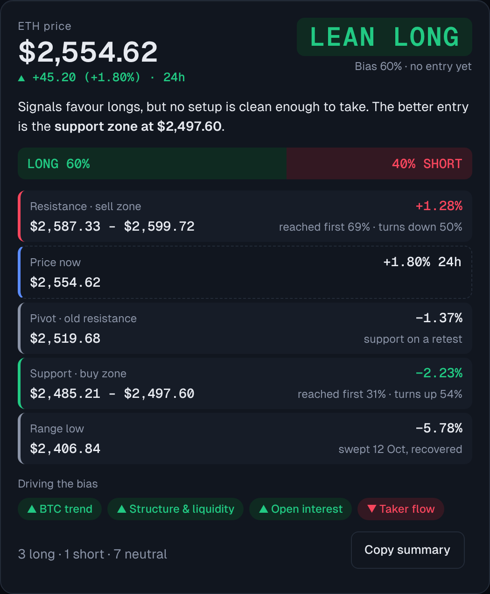
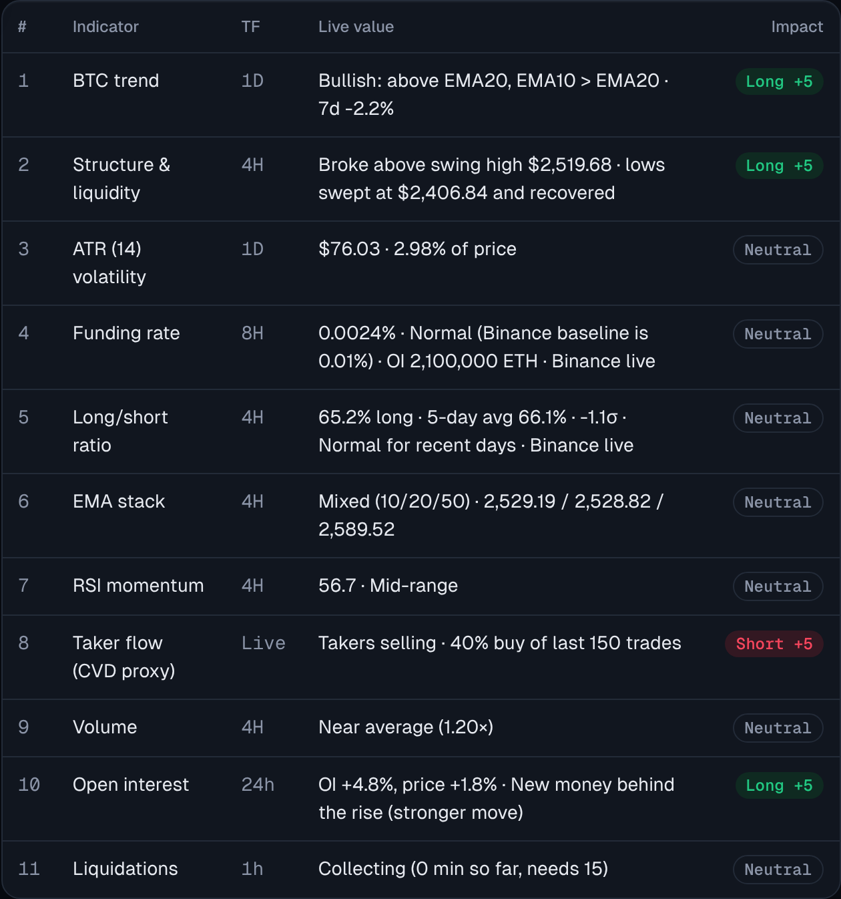
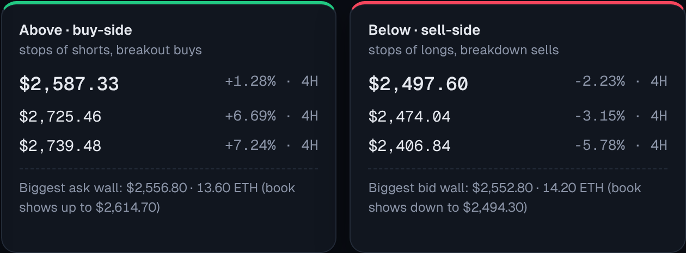
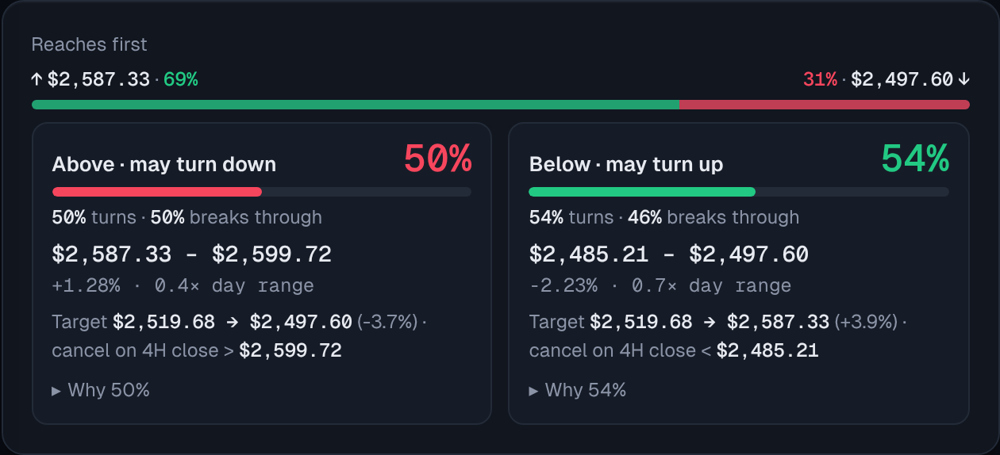
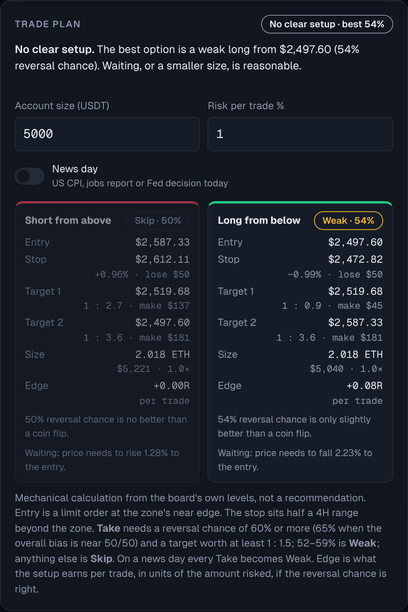
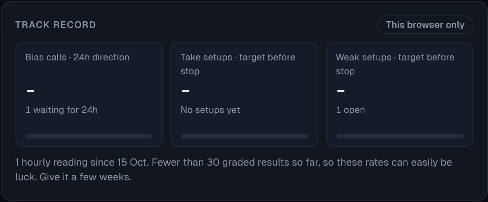
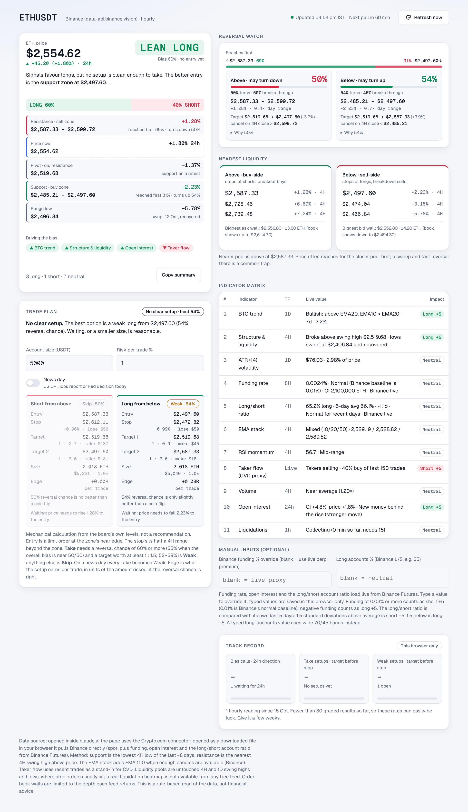

# ETHUSDT Signal Board

A single-page, live dashboard that turns ETH/USDT market data into a plain trading read: **current price, support, resistance, nearest liquidity on both sides, and a Long % / Short % bias** scored from an 11-indicator matrix, plus a reversal watch, a ready-made trade plan with position sizing, and a track record that grades the board's own calls. It refreshes itself every hour and works on phone, tablet and desktop.



<p align="center">
  
  &nbsp;&nbsp;
  
</p>

> Screenshots show sample data captured on 15 Oct 2026 in browser mode (Binance), with a $5,000 account entered in the trade plan. Live numbers will differ.

---

## Contents

- [What it shows](#what-it-shows)
- [Data sources](#data-sources)
- [The indicator matrix](#the-indicator-matrix)
- [Support, resistance and liquidity](#support-resistance-and-liquidity)
- [Reversal watch](#reversal-watch)
- [Trade plan](#trade-plan)
- [Track record](#track-record)
- [Running it](#running-it)
- [Manual inputs](#manual-inputs)
- [Interface](#interface)
- [Project structure](#project-structure)
- [Changing the rules](#changing-the-rules)
- [Limitations](#limitations)
- [Disclaimer](#disclaimer)

---

## What it shows

The top card is a **decision card**. It answers one question, which way to trade right now, and leaves the detail to the cards below.



| Part | What it tells you |
|---|---|
| **Price and 24h change** | Current price, with the change over the last 24 hours, e.g. ▲ +45.42 (+1.81%) · 24h |
| **The call** | One word: **LONG** or **SHORT** when a setup qualifies as Take, **LEAN LONG** or **LEAN SHORT** when the bias is 60%+ but no entry is clean yet, or **WAIT** when signals are split. A sentence under it gives the reason or the order: e.g. "Buy at $2,497.60, stop $2,472.82, targets $2,519.68 → $2,587.33 (up to 1 : 3.6). Wait for price to reach the entry." |
| **Long / Short bar** | The bias from the 11 indicators |
| **Price ladder** | Every level that matters on one map, highest first: resistance (sell) zone, current price, pivot, support (buy) zone and range low. Each shows its distance from price, and the two zones also show which one is likely reached first and the chance price turns there |
| **Driving the bias** | Only the signals actually pushing the score, as green ▲ (long) and red ▼ (short) chips. Hover or long-press a chip for its live value |
| **Copy summary** | Copies the classic five lines plus liquidity, reversal and trade-plan lines, ready to paste anywhere |

Below it:

| Section | What you get |
|---|---|
| **Trade plan** | Entry, stop, two targets, risk-to-reward, position size from your account and risk %, and a Take / Weak / Skip verdict for each reversal setup, plus an overall "No clear setup" flag |
| **Reversal watch** | For the nearest zone above and below price: the chance price turns there if it gets there, which is reached first, the target if it turns, the 4H close that cancels the setup, and (under **Why**) the top three reasons |
| **Nearest liquidity** | The three closest liquidity pools above price (buy-side) and below price (sell-side), each with its distance in %, plus the biggest order-book wall on each side |
| **Indicator matrix** | All 11 indicators' live values and whether each adds Long +5, Short +5 or stays neutral |
| **Manual inputs** | Optional boxes to override funding rate and the long/short account ratio |
| **Track record** | How often past bias calls and setups were right, graded automatically from later candles |

Copy summary keeps the original five-line format at the top:

```
Current value: $2,554.62 (24h +45.42, +1.81%)
Support: $2,406.84 (downside liquidity swept)
Resistance: $2,587.33 ($2,519.68 passed, now first support on a retest)
Long: 55%
Short: 45%
```

## Data sources

The page picks its source automatically, based on where it is opened:

| Opened in | Source | What it pulls |
|---|---|---|
| **claude.ai** (as a published artifact) | Crypto.com connector | ETH_USDT ticker (price and 24h change), 4H and 1D candles (50 each), BTC_USDT 1D candles, last 150 trades, order book (50 levels), ETH perpetual mark price, ETH index price, perpetual open interest (its 24h change is measured against the board's own reading from a day earlier) |
| **A browser** (local file or any web host) | Binance public API, no key needed | ETHUSDT 24h ticker (price and 24h change), 4H candles (150), 1D candles (60), BTCUSDT 1D candles, last 500 aggregated trades, order book (1,000 levels), and from Binance Futures: funding rate, mark/index price, open interest, global long/short account ratio (last 30 four-hour readings), open-interest history (last 25 hours), and the live liquidation stream (`ethusdt@forceOrder` WebSocket) |

The header shows which source is active, for example `Crypto.com spot · hourly` or `Binance (data-api.binance.vision) · hourly`.

In browser mode the page tries seven Binance market-data hosts in order until one answers: `data-api.binance.vision`, `api.binance.com`, `api1` to `api4.binance.com`, and `api-gcp.binance.com`. If Binance Futures can't be reached, the funding and long/short rows fall back to the manual boxes.

## The indicator matrix



The bias starts at **50 / 50**. Each indicator moves it by **5 points** toward Long or Short, or leaves it alone. The final value is clamped between 5% and 95%.

| # | Indicator | Timeframe | Long +5 when | Short +5 when |
|---|---|---|---|---|
| 1 | **BTC trend** | 1D | BTC is above its EMA 20 and EMA 10 > EMA 20 | BTC is below its EMA 20 and EMA 10 < EMA 20 |
| 2 | **Structure & liquidity** | 4H | Price has closed above a recent 4H swing high (last 15 bars) | Price has closed below a recent 4H swing low (last 15 bars) |
| 3 | **ATR (14) volatility** | 1D | Never (information only) | Never |
| 4 | **Funding rate** | 8H | Funding is negative (shorts paying) | Funding is 0.03% or higher (crowded longs). Binance's normal baseline is 0.01%, so that alone is neutral |
| 5 | **Long/short ratio** | 4H | Long accounts are 1.5 standard deviations **below** their 5-day average (contrarian) | 1.5 standard deviations **above** their 5-day average (contrarian) |
| 6 | **EMA stack** | 4H | 10 > 20 > 50 (> 100 when available) | 10 < 20 < 50 (< 100 when available) |
| 7 | **RSI (14) momentum** | 4H | RSI 60 to 70, or RSI 30 or below (oversold) | RSI 70 or above (overbought), or RSI 30 to 40 |
| 8 | **Taker flow** (CVD proxy) | Live | More than 55% of recent trade volume was taker buys | Less than 45% was taker buys |
| 9 | **Volume** | 4H | Last closed bar is 1.2× its 20-bar average on a green candle, or volume is low (0.8× or less) after a fall | Same high volume on a red candle, or low volume after a rise (move unconfirmed) |
| 10 | **Open interest** | 24h | Open interest up 2%+ while price is up 0.5%+ (new money behind the rise) | Open interest up 2%+ while price is down 0.5%+ (new shorts behind the drop) |
| 11 | **Liquidations** | 1h | 75%+ of the last hour's liquidations (at least $250K in total) hit longs: a flush that often snaps back up | 75%+ hit shorts: a squeeze that often snaps back down |

Open interest falling while price moves (shorts or longs closing) is shown as a weaker move but scores neutral. Liquidations need 15 minutes of stream data after the page opens, and are available only in browser mode (Binance); inside claude.ai the row says so and stays neutral.

**Why these thresholds.** Binance's funding rate sits at 0.01% per 8 hours whenever the market is calm, so only clearly elevated funding (0.03%+) counts as crowded. Retail accounts on Binance lean long most of the time, so a fixed cut-off like "60% long" would fire almost constantly. Instead, the board loads the last 30 four-hour readings (5 days) and flags only a reading that is unusual compared with them.

**Funding source, in order of priority:**

1. A value typed into the manual box
2. Binance's live funding rate (browser mode)
3. On Crypto.com, the gap between the ETH perpetual's mark price and the spot index. A premium of +0.05% or more counts as crowded longs (Short +5), and −0.05% or less counts as Long +5.

**EMA stack:** Crypto.com returns 50 candles, so the stack uses EMA 10/20/50. Binance returns 150, so EMA 100 is added.

## Support, resistance and liquidity



All levels come from closed candles only. The candle that is still forming is ignored.

| Level | How it is found |
|---|---|
| **Support** | The lowest 4H low of the last 50 closed bars (about 8 days). Labelled "downside liquidity swept" when price has since recovered more than 3% above it. |
| **Resistance** | The nearest 4H swing high above price. If none exists in the window, the 50-bar high. |
| **Passed level** | The highest swing high below price formed in the last 15 bars, i.e. a resistance price has broken. It is shown as the first support on a retest. |
| **Swing high / low** | A bar whose high (or low) is beyond the two bars on each side of it. |
| **Liquidity pools** | Swing highs above price and swing lows below price, on both 4H and 1D, that price has **not traded through since**. Stop orders tend to cluster just beyond them. The three nearest on each side are shown, merged so levels within 0.2% of each other count once. Two swings within 0.15% are tagged **equal levels**, a stronger pool. |
| **Order-book walls** | The largest resting ask and bid in the order book snapshot. The note under each shows how far that snapshot reaches. |

The note under the liquidity cards names the **nearer pool**. Price often reaches for the closer pool first, and a quick sweep through it followed by a reversal is a common trap.

## Reversal watch



For the nearest liquidity pool on each side, the board estimates how likely price is to **turn around there if it reaches the zone**. It's a conditional chance: it says nothing about whether price will get there.

| Card | Zone | Target if it turns | Cancelled when |
|---|---|---|---|
| **Above · may turn down** | Nearest buy-side pool, up to half a 4H ATR above it (stops get swept just past the level) | The pivot level in between, if any, then the nearest pool below | A 4H candle closes above the zone |
| **Below · may turn up** | Nearest sell-side pool, down to half a 4H ATR below it | The pivot level in between, if any, then the nearest pool above | A 4H candle closes below the zone |

The distance to each zone is shown in % and in multiples of the daily ATR, so you can see how far price has to travel.

**Why the two cards don't add up to 100%.** Each card answers a different question about a different event: *if* price reaches the upper zone, does it turn or break through? *If* price reaches the lower zone, does it turn or break through? So each card is its own 100%, shown as e.g. `64% turns · 36% breaks through`. Both can be high at once (a range where buyers and sellers each defend their side) or both low (a breakout market).

**Reaches first.** The one pair that does add up to 100% is which zone price touches first. Each side shows the price level it refers to (the near edge of each reversal zone), for example `↑ $2,587.33 · 64%` and `36% · $2,497.60 ↓`. It starts from a random-walk estimate: the chance of reaching the upper zone first equals the distance to the lower zone divided by the total distance between them. That's then tilted by half the Long/Short bias's distance from 50, and clamped between 10% and 90%. With price $32 below the upper zone and $57 above the lower one, a 50/50 bias gives about 64% above, 36% below.

**How the chance is scored.** Each zone starts at 50%. Factors that favour a turn add points and factors against it subtract. The result is clamped between 20% and 85%. Shown for the upper zone; the lower zone mirrors every rule.

| Factor | Points | For a turn down from above |
|---|---|---|
| 4H trend (EMA stack) | ±10 | +10 if the stack is bearish (the rally is counter-trend), −10 if bullish |
| BTC daily trend | ±5 | +5 if bearish, −5 if bullish |
| RSI (14) on 4H | +5 / +10 | +5 at 60 or above, +10 at 70 or above |
| Equal levels | +8 | Two swing highs within 0.15%: a sweep then reversal is common |
| Daily swing level | +6 | The pool comes from the 1D chart |
| Stacked pools | +4 | Another pool sits within one 4H ATR behind it |
| Volume into the move | ±6 | +6 if the recent rise is on weak volume (≤ 0.8×), −6 if on strong volume (≥ 1.2×) |
| Taker flow | ±5 | +5 if takers are selling (< 45% buys), −5 if buying (> 55%) |
| Funding | ±5 | +5 if longs are paying (crowded), −5 if shorts are paying |
| Long/short ratio | ±5 | +5 if accounts are unusually long for recent days, −5 if unusually short |

Tap **Why** on a card to see the three factors with the biggest effect. Copy summary adds one line per zone, e.g. `Reversal down from $2,587.33–$2,599.72: 55% (target $2,519.68 → $2,497.60)`.

**Read it as a weighting of the evidence, not a measured probability.** The weights are rule-based and have not been backtested. Around 50% means the signals disagree; 65% or more means several of them line up.

## Trade plan



Turns each reversal setup into a concrete order, using only the board's own levels. It's a mechanical calculation, not a recommendation.

| Field | How it is set |
|---|---|
| **Entry** | A limit order at the zone's near edge: the bottom of the upper zone for a short, the top of the lower zone for a long |
| **Stop** | Half a 4H ATR beyond the zone's far edge, so one 4H ATR from the entry |
| **Target 1 / 2** | The reversal card's targets: the pivot level in between (if any), then the opposite liquidity pool. Each shows its reward as a multiple of the risk, e.g. `3.6R` |
| **Size** | Enter your account size (USDT) and the % you're willing to lose if stopped out (default 1%). Size = amount at risk ÷ stop distance, shown in ETH, in dollars, and as the leverage it needs |
| **Edge** | `2 × reversal chance − 1`, in units of the amount risked. Under a random walk any target/stop pair is worth zero on average whatever the distances, so the only edge comes from the reversal chance being above 50%. 54% gives +0.08R per trade |

**Verdict per setup**

| Verdict | Rule |
|---|---|
| **Take** | Reversal chance 60% or more (65% or more when the overall Long/Short bias is 46–54%, i.e. near 50/50), and a target worth at least 1 : 1.5 |
| **Weak** | Reversal chance 52–59% (with enough reward) |
| **Skip** | Reversal chance below 52%, or no target worth 1.5× the risk |

Every label carries the reversal chance it's based on: the setup chips read `Take · 66%`, `Weak · 54%` or `Skip · 50%`, and the card's headline chip reads `Setup: Short · 66%`, or `No clear setup · best 54%` when nothing qualifies. A setup is also shown as off when price has already moved through its zone. The card's headline names the best live setup. If none reaches **Take**, it shows **No clear setup** and says why: waiting is a valid decision. Copy summary adds a `Trade plan:` line.

**Risk and reward in money.** Each target shows its ratio as `1 : 2.7`. With an account size entered, the stop row shows the dollar loss (`lose $50`) and each target the dollar gain (`make $137`).

**News day switch.** Levels and indicators often fail around US CPI, jobs-report and Fed-decision releases. Switch **News day** on and every Take becomes Weak, with a warning on the card. The switch resets the next day. The board can't fetch an economic calendar itself, so check one, or ask Claude "any big US data or Fed events today?".

Account size, risk % and the News day switch are saved in your browser only.

## Track record



*On day one every tile shows a dash; results appear as readings age and get graded.*

The board grades its own calls, so you can see whether its percentages deserve trust.

**What it saves.** One reading per hour while the board is open: price, Long/Short bias, open interest, and both trade-plan setups (entry, stop, Target 1, verdict, reversal chance). Inside claude.ai readings go to the board's own storage and follow you across devices; in the downloaded file they stay in that browser. The chip on the card says which.

**How it grades.** Only closed 4H candles that opened after the reading are used.

| Graded item | Counts as right when |
|---|---|
| **Bias call** (Long 55%+ or Short 55%+) | The 4H close 24 hours later is above (Long) or below (Short) the price at the reading |
| **Setup** (Take or Weak) | The entry is touched within 48 hours, then Target 1 is reached before the stop. Not touched in 48h = never filled. Filled but undecided after 7 days = timed out |

If the entry or the stop and the target fall inside the same 4H candle, the order inside the candle is unknown, so it counts as a **loss**. A setup that stays on the board for many hours is counted **once**. Net result is shown in R (Target 1's ratio for a win, −1 for a loss).

**Reading it.** With fewer than about 30 graded results, a hit rate can easily be luck, and the card says so. Give it a few weeks. If Take setups keep losing, don't trust the reversal chances.

## Running it

### Option 1: inside claude.ai (Crypto.com data)

1. Connect the **Crypto.com** connector in claude.ai (no account or API key needed).
2. Open the published artifact. The first time, allow it to use Crypto.com.
3. It loads immediately and refreshes every hour while open.

### Option 2: in a browser (Binance data)

1. Download `index.html`.
2. Open it in **Chrome, Edge, Firefox or Safari**. On Android, open it **with Chrome** (long-press the file → Open with → Chrome). The built-in "HTML Viewer" and the in-app preview in the Claude app block outside connections.
3. It refreshes every hour while the tab stays open.

To check whether your network can reach Binance, open this in your browser:

```
https://data-api.binance.vision/api/v3/ticker/price?symbol=ETHUSDT
```

If it shows a price, the board will work. If not, Binance is blocked on that network. Try mobile data or use Option 1.

### Option 3: GitHub Pages

1. In this repository go to **Settings → Pages**.
2. Under **Build and deployment**, choose **Deploy from a branch**, branch `main`, folder `/ (root)`.
3. Open `https://chiefmahesh.github.io/ethusdt-signal-board/`. It runs in browser mode with Binance data.

## Manual inputs

| Box | When to use it | Effect |
|---|---|---|
| **Funding %** | To use a specific funding rate, e.g. `0.0024` | Overrides the live value. 0.03% or more → Short +5. Negative → Long +5. |
| **Long accounts %** | On Crypto.com, which has no long/short ratio, e.g. `65` | A typed value has no history to compare with, so it uses wide bands: 70% or more → Short +5. 45% or less → Long +5. |

Leave a box blank to use the live value. Typed values are saved in that browser only.

## Interface

- **Responsive.** Phone: one column, and the indicator table turns into cards. Tablet: the two liquidity panels sit side by side. Desktop (1024px and wider): two columns, with the decision card and trade plan on the left, and reversal watch, liquidity, the matrix, inputs and track record on the right.
- **Light and dark themes** follow the device setting.

  

- **Refresh animation.** The icon spins and a progress line sweeps the button. Values dim while loading. When data arrives, the price counts to its new value with a green or red glow showing which way it moved since the last refresh, changed indicators flash, and the button shows **Updated** (or **Failed**, with a shake).
- **No layout jumping.** Placeholders reserve the space real values will take, and the refresh button has a fixed width, so nothing moves during load or refresh.
- **Reduced motion.** With the device's "reduce motion" setting on, animations are switched off.

## Project structure

```
ethusdt-signal-board/
├── index.html          Built page: open this, or host it (generated by build.py)
├── build.py            Inlines src/engine.js into src/page.src.html → index.html
├── src/
│   ├── engine.js       All calculations: EMA, RSI, ATR, swing pivots, scoring, liquidity pools
│   └── page.src.html   Layout, styles, data fetching (Crypto.com and Binance), animations
└── screenshots/
    ├── desktop-dark.png      Full page, dark theme
    ├── desktop-light.png     Full page, light theme
    ├── mobile-dark.png       Phone, first screen, dark
    ├── mobile-light.png      Phone, first screen, light
    ├── decision-card.png
    ├── indicator-matrix.png
    ├── liquidity.png
    ├── reversal-watch.png
    ├── trade-plan.png
    └── track-record.png
```

The page is self-contained. It needs no build tools, packages or server, and the only external request besides market data is the Geist and Geist Mono fonts from Google Fonts. Without the font it falls back to the system font.

After editing anything in `src/`, rebuild:

```bash
python3 build.py
```

## Changing the rules

All scoring lives in `src/engine.js`, inside `analyze()`. Each indicator is one `add(...)` call. The last argument is its points (`5` = Long +5, `-5` = Short +5, `0` = neutral).

| To change | Look for |
|---|---|
| Points per signal | The `5` / `-5` values in each `add(...)` call |
| RSI bands | `if (r >= 70)` … `else if (r <= 40)` |
| Taker flow thresholds | `buyShare > 55` / `buyShare < 45` |
| Volume thresholds | `ratio >= 1.2` / `ratio <= 0.8` |
| Funding thresholds | `funding >= 0.03` (typed or Binance) and `premium >= 0.05` (Crypto.com proxy) |
| Long/short thresholds | `z >= 1.5` / `z <= -1.5` against the 5-day history, and `lsLong >= 70` / `lsLong <= 45` for typed values |
| Swing detection width | `pivots(win, 2)` (2 bars each side) |
| Support window | `closed4h.slice(-50)` |
| Equal-level tolerance | `0.0015` in `pools()` (0.15%) |
| Reversal factor weights and the 20–85% clamp | `reversal()` in `src/engine.js` |
| Open interest / liquidation thresholds | `Math.abs(oiChg) < 2`, `pc > 0.5` and `tot < 250000`, `/ tot >= 0.75` in `analyze()` |
| Track-record grading (24h bias horizon, 48h fill window, 7-day timeout) | `gradeReading()` in `src/engine.js` |
| Refresh interval | `const HOUR = 3600000;` in `src/page.src.html` |

`engine.js` has no dependencies and also runs in Node.js:

```js
require("./src/engine.js");
const result = globalThis.EthEngine.analyze({ price, eth4h, eth1d, btc1d, trades });
```

Candles are arrays of `{ t, o, h, l, c, v }` sorted oldest first. Trades are `{ side: "buy" | "sell", q }`.

## Limitations

- **No liquidation heatmap.** No free data source provides one. The liquidity pools are an estimate of where stop orders sit, based on untouched swing levels.
- **CVD is approximated** from the most recent trades (150 on Crypto.com, 500 on Binance), not a cumulative series.
- **Crypto.com has no long/short account ratio**, so that row stays neutral there unless you type a value.
- **Crypto.com funding is a proxy** (perpetual premium over the index), not an actual funding rate.
- **Crypto.com's order book is shallow** (50 levels, about ±$2 from price), so its walls only describe the price right next to market.
- **Prices differ slightly between exchanges.** Crypto.com and Binance usually agree within a few dollars.
- **Reversal chances are not backtested.** They weight the current signals with fixed rules; they are not measured hit rates.
- **Updates need the page open.** It refreshes hourly only while the tab or artifact is open, and doesn't send notifications. The track record only gets readings for hours when the board was open.
- **Liquidations start from zero** each time the page opens (there's no free history), and Binance's stream reports at most one liquidation per second, so totals undercount.

## Disclaimer

This board applies fixed rules to public market data. It is **not financial advice** and makes no prediction about price. Crypto trading carries a high risk of loss. Do your own research and manage your risk.
